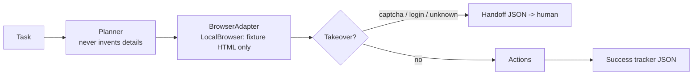

# Computer-Use Agent

[](https://github.com/lionelsimai/computer-use-agent/actions/workflows/ci.yml)
[](LICENSE)
[](https://www.python.org/)

**Offline fixture-site agent core: planner, typed actions and human
takeover — exercised end-to-end against a bundled local HTML site.**

**Target:** 90% task success, human takeover under 10% — an aspirational
target for a future live-browser adapter. No live-site measurement
exists yet; the only numbers measured today are the fixture ones below.
**Shows:** You ship agents in the messy real world.

## What this is — and is not
This package ships the *core* of a computer-use agent: a rule-based
planner that turns task text into typed actions
(goto/click/fill/extract/submit), an executor for those actions,
takeover detection (captcha / login wall / 2FA / empty page) with a
persistent JSON handoff, and a success tracker.

It is **not** a live browser agent. The only executor that ships is
`LocalBrowser`, a standard-library parser over static fixture HTML.
There is no network code, no JavaScript execution, and no Playwright
backend in this repository (an earlier version implied otherwise; that
claim was wrong and was removed in 0.1.1). A live adapter would
implement the documented `BrowserAdapter` interface
(`execute(Action) -> StepResult`); none is provided today.

## Correctness rules (0.1.1)
- Clicking a link that does not exist **fails** (`ok=False`) — it no
  longer reports success for a no-op.
- Submit validates the required form fields and derives the
  confirmation from the submitted values; an empty form cannot
  "succeed".
- Extracting a target that is not on the page **fails** instead of
  returning the whole page.
- The planner **never invents details**: a booking task without a
  guest name or party size fails honestly rather than booking for a
  fabricated guest.
- Page loads are jailed to the fixture directory
  (`Path.is_relative_to`); absolute paths and `../` escapes are
  refused.
- Handoff and tracker files are written to a persistent `--out-dir`
  (default `./agent-output`), not a temp directory that vanishes when
  the process exits.

## Architecture


## Quickstart (<2 min)
```bash
git clone https://github.com/lionelsimai/computer-use-agent.git
cd computer-use-agent
pip install -e .
computer-use-agent demo
computer-use-agent run "Book a table for Alex Tan for 2 guests"
```
No network or browser download needed: everything runs against the
bundled local HTML fixture site, and outputs land in `./agent-output`.

## Real demo output
```
[PASS] Book a table for Alex Tan for 2 guests steps=6 extracted='Booking confirmed for Alex Tan - 2 guests'
[PASS] Extract the price from the menu steps=2 extracted='Price: $42 per person'
[PASS] Book a table for Maria Lim for 4 guests steps=6 extracted='Booking confirmed for Maria Lim - 4 guests'
[TAKEOVER] captcha task takeover=True reason='captcha'
success_rate: 0.75 takeover_rate: 0.25
```
(The demo's 0.25 takeover rate is the deliberate captcha probe, counted
in the demo's own rates; the benchmark separates genuine tasks from the
probe.)

## Benchmarks
```bash
python benchmarks/bench.py
```
Fixture-site run (2026-11-09): 4 genuine tasks, each counted once —
genuine success rate 1.00; including the deliberate captcha probe,
overall success 0.80 and takeover 0.20. These are fixture numbers
only: they say nothing about performance on real websites.

## Limitations (honest)
- No live browsing: static fixture HTML only — no network, no
  JavaScript, no screenshots or visual grounding.
- Planner is rule-based for fixture intents; arbitrary tasks need an
  LLM planner behind the same interface.
- Takeover detection is marker-based and will miss novel challenge
  designs; on a real site it would also false-positive on pages that
  merely *discuss* captchas.
- Confirmation synthesis models what a booking site would return; it
  is derived from submitted values, but no real reservation is made.

## Roadmap
- [ ] A real live-browser adapter implementing `BrowserAdapter`
- [ ] LLM planner interface, visual grounding for element location
- [ ] Live-site benchmark suite with consenting test sites

## Contributing
See [CONTRIBUTING.md](CONTRIBUTING.md). Licence: MIT — see [LICENSE](LICENSE).
