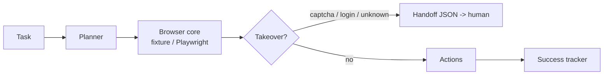

# Computer-Use Agent

[](https://github.com/lionelsimai/computer-use-agent/actions/workflows/ci.yml)
[](LICENSE)
[](https://www.python.org/)

**Browser agent that books, fills, extracts on live sites.**

**Target:** 90% task success, human takeover under 10%.
**Shows:** You ship agents in the messy real world.

## Problem -> Solution
Real websites have captchas, login walls and shifting layouts. Demo agents
ignore them and fail silently. This agent plans typed actions
(goto/click/fill/extract/submit), detects takeover states on every page load,
hands off to a human with a structured file, and tracks real success rates.

## Architecture


## Quickstart (<2 min)
```bash
git clone https://github.com/lionelsimai/computer-use-agent.git
cd computer-use-agent
pip install -e .
computer-use-agent demo
computer-use-agent run "Book a table for Alex Tan for 2 guests"
```
No network or browser download needed: the demo runs against a bundled local
HTML fixture site. Install `.[playwright]` for real-browser backends.

## Real demo output
```
[PASS] Book a table for Alex Tan for 2 guests steps=6 extracted='Booking confirmed - see you soon'
[PASS] Extract the price from the menu steps=2 extracted='Price: $42 per person'
[PASS] Book a table for Maria Lim for 4 guests steps=6 extracted='Booking confirmed - see you soon'
[TAKEOVER] captcha task takeover=True reason='captcha'
success_rate: 0.75 takeover_rate: 0.25
```
(The 0.25 takeover rate in the demo is the deliberate captcha probe; genuine
tasks are measured separately in the benchmark — see below.)

## Benchmarks
```bash
python benchmarks/bench.py
```
Measures genuine-task success and takeover rate on the fixture site.
Target on live sites: 90% success, <10% takeover.

## Limitations (honest)
- Offline core parses static HTML; JavaScript-heavy sites need Playwright.
- Planner is rule-based for fixture intents; arbitrary sites need an LLM planner.
- Takeover detection is marker-based and will miss novel challenge designs.

## Roadmap
- [ ] Playwright backend parity test, LLM planner interface
- [ ] Visual grounding for element location, session replay
- [ ] Live-site benchmark suite with consenting test sites

## Contributing
See [CONTRIBUTING.md](CONTRIBUTING.md). Licence: MIT — see [LICENSE](LICENSE).
